# Using Image Forensics Analysis

[Frontend installation](../README.md) · [Backend installation](https://github.com/In-dialog/image-forensics-backend#readme) · [Refresh these screenshots](SCREENSHOTS.md)

Use Image Forensics Analysis to examine a saved image analysis or create a new one. This guide follows the main decisions, then shows how to read the results. The numbered markers in each screenshot match the explanations directly below it.

The results viewer works without the backend. New analyses require the backend, its models, and the optional forensic tools you select. Start with the installation instructions in the frontend and backend READMEs; this guide begins after the website opens.

Screenshots use the released interface and a bundled example dataset. The analysis configuration, progress and recovery screens use controlled demonstration states. They illustrate the controls, not a measured run time or a new forensic conclusion. Saved model interpretations are evidence to review, not verified facts about the people or events depicted.

## Find a task

- [Choose a starting point](#01-home)
- [Choose the image and the work to perform](#02-executor)
- [Tell the analyzer what to detect](#03-detection)
- [Ask the questions that matter](#04-questions)
- [Define meaningful ranking criteria](#05-rankings)
- [Follow a running analysis](#06-progress)
- [Resume unfinished work](#07-resume)
- [Open a saved result](#08-database)
- [Inspect the scene and its elements](#09-image-views)
- [Read whole-image ratings](#10-semantics)
- [Find patterns across items](#11-groups)
- [Check the evidence for one item](#12-item)

## Choose a starting point

Open the website. Choose View database to explore saved work, or New analysis to prepare a run.

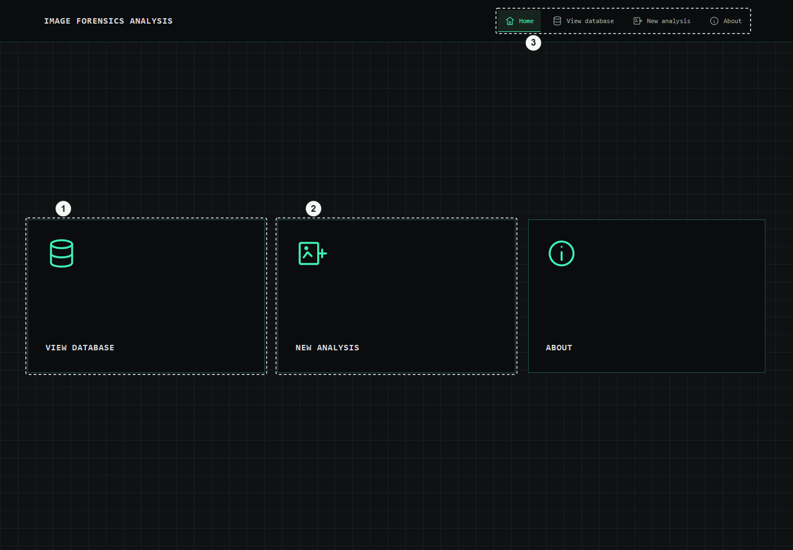

1. **View database.** Opens the included examples and analyses downloaded into this frontend. Viewing them does not load AI models or require a running backend.
2. **New analysis.** Opens the Executor, where you choose an image and the stages to run. The backend must be available to load its configuration and start work.
3. **Workspace navigation.** The top navigation is available throughout the app. Home returns here; View database opens saved results; New analysis opens the run controls; About describes the project.

The frontend and backend have separate data folders. The frontend downloads completed results; it does not need shared access to the backend folder. Closing a browser tab does not stop an analysis service.

## Choose the image and the work to perform

Select Choose image, review the stage checkboxes, and use Start analysis when the configuration is ready.

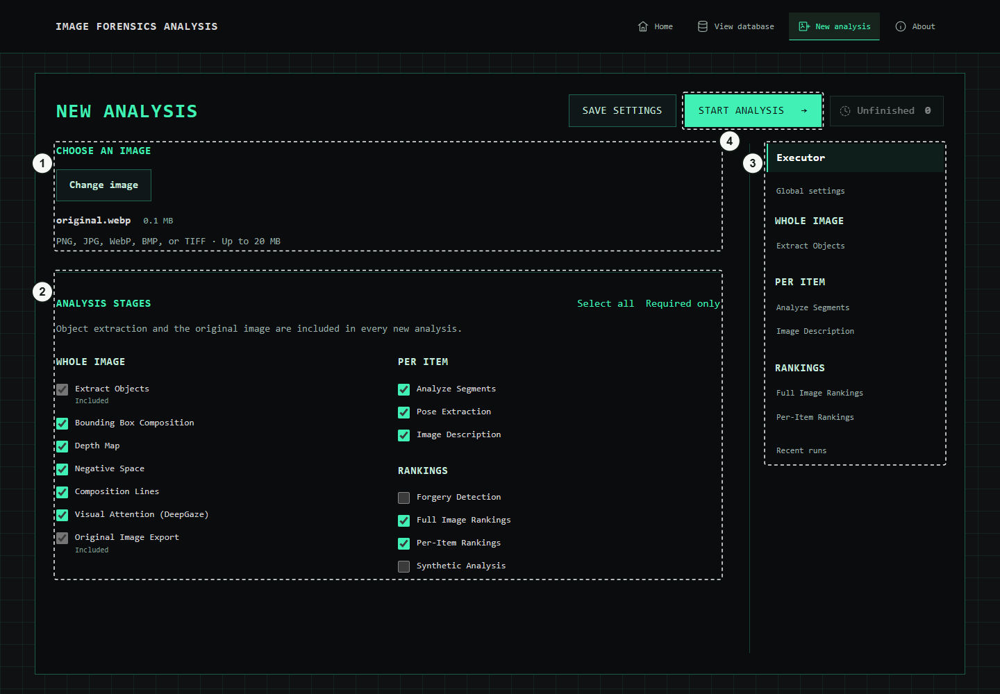

1. **Choose image.** Select one PNG, JPEG, WebP, BMP or TIFF image up to 20 MB. Change image replaces the selection before the run starts. The original input is kept by the backend; JPEG bytes are preserved for forensic checks.
2. **Analysis stages.** Checkboxes decide which outputs to produce. Select all enables every stage; Required only keeps object extraction and original-image export. Those two required stages cannot be unchecked. Optional forgery and synthetic stages need their extra backend installation.
3. **Configuration navigation.** Executor controls what runs. Global settings selects the shared processing device. The other entries edit stage-specific instructions, questions or rankings. Opening a settings tab does not enable that stage; use its Executor checkbox.
4. **Start analysis.** Starts one sequential pipeline using a snapshot of the current image, settings and prompts. Save settings stores defaults for later runs without starting one. Start stays disabled until an image and valid configuration are present.

In Global settings, Automatic lets the runtime choose the device; CPU avoids CUDA; CUDA GPU requests the supported NVIDIA setup. Advanced settings contains minimum item size and synthetic-service connection controls. A device selection cannot add support for unsupported hardware.

## Tell the analyzer what to detect

Open Extract Objects in the right-hand navigation. Describe the visible subjects that matter for your analysis.

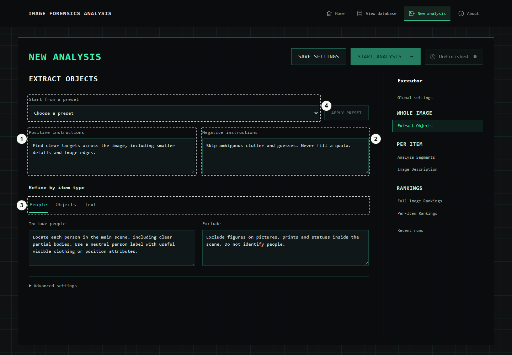

1. **Positive instructions.** Define the focus: which visible objects, people, marks, small details or readable text matter? Prefer observable features and relationships. For example: include discarded containers, attached signs, printed graphics and emblems that are visible in the scene.
2. **Negative instructions.** State exclusions separately: avoid guessing unreadable words, inventing identities, or treating an ambiguous mark as a definite affiliation. Exclusions guide interpretation; they are not output-format instructions.
3. **People / Objects / Text.** Choose an item type to refine its Include and Exclude instructions. The shared instructions still apply. Analyze Segments uses the same editor for finding parts within detected items.
4. **Presets.** Choose a starting profile, then Apply preset. Applying replaces the current profile for this stage, so review it before continuing. Edit the analysis objective in these fields; the application owns the JSON output structure.

The pipeline detects regions and then extracts their masks. A person, a shirt, and a graphic printed on that shirt can be different useful regions. Contextual analysis can use the full scene, a nearby view and the target region so a crop is not interpreted in isolation. It still must distinguish visible evidence from uncertain associations.

## Ask the questions that matter

Open Image Description. Select a question on the left and edit its title and instruction on the right.

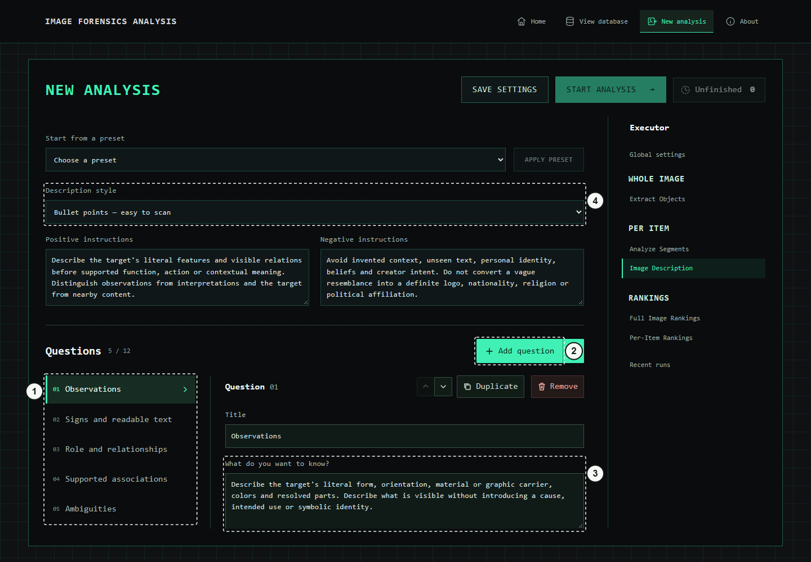

1. **Question list.** Select the question you want to edit. Its title becomes a recognizable label in the saved results. Questions can cover literal inventory, visible text, relationships, supported interpretations or uncertainty.
2. **Add and manage questions.** Add question creates a new entry; the adjacent arrow opens templates. Duplicate copies the selected entry, the arrow buttons change its order, and Remove deletes it. At least one question is required, up to twelve.
3. **Question instruction.** Write one clear analytical request. Example: “Which visible details support the proposed use of this object, and which details remain ambiguous?” The title is a short display label; this longer instruction tells the model what to answer.
4. **Answer style.** Concise requests short answers, Detailed asks for more context and visible evidence, and Bullet points favors scanning. Shared positive and negative instructions apply to all questions in this profile.

Advanced settings exposes the model, context and generation controls. Leave these alone for an initial run unless your model or hardware requires a change. Questions change what you ask; they do not let you edit response keys, schemas or filenames.

## Define meaningful ranking criteria

Open Full Image Rankings for a scene-level assessment, or Per-Item Rankings for objects and parts. Select a criterion to define its answer type and evidence.

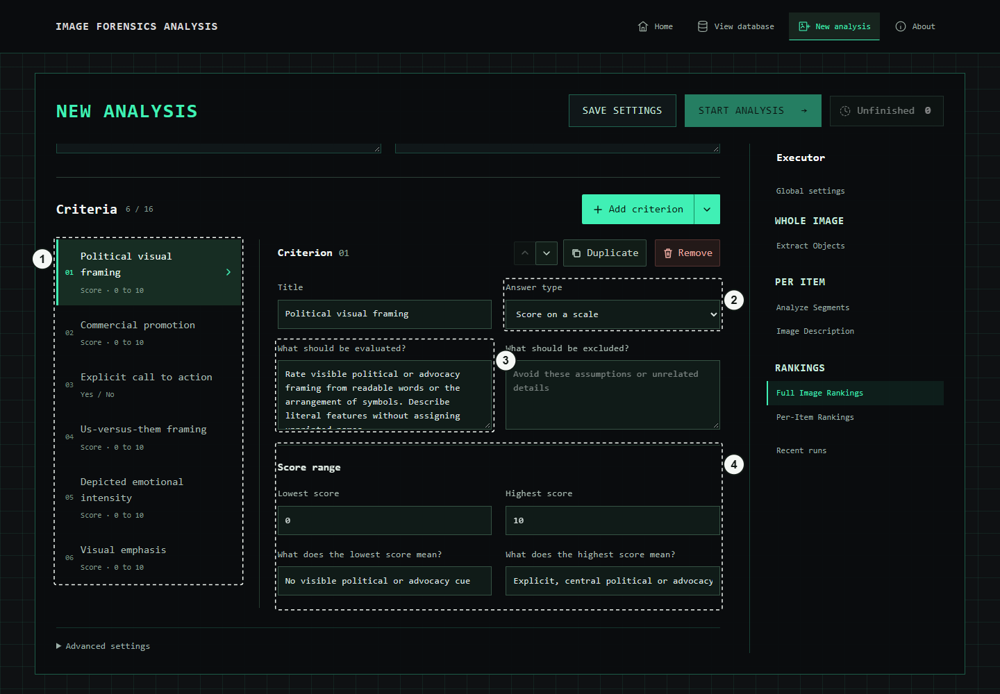

1. **Criteria.** Each criterion has its own label and definition. Select one to edit it. Add criterion and its template menu create more; Duplicate, reorder and Remove work like the question editor. The viewer reads these saved labels and types, including custom criteria.
2. **Answer type.** Score on a scale uses numeric endpoints. Choose a category uses a list of allowed answers. Yes / No asks a binary question. Select the type that fits the question rather than turning every concept into a percentage.
3. **Evaluation and exclusions.** Specify observable evidence for the selected criterion. Define what should count and use What should be excluded? for assumptions or irrelevant signals. For example, separate visible promotional language from the mere presence of a product.
4. **Score range and anchors.** Set the lowest and highest score, then explain the meaning of each end. A 0–10 criterion might range from no visible cue to explicit, central evidence. Category criteria instead show Allowed answers with Add choice and individual remove controls.

Unknown or insufficient evidence is distinct from zero and from No. A displayed score percentage means position within that criterion’s configured range; it is not a probability, confidence estimate or percentage of the image. Use an explicitly defined criterion if you want to assess another concept.

## Follow a running analysis

After Start analysis, the setup panel becomes an output monitor. Watch the current stage and item progress while previews appear.

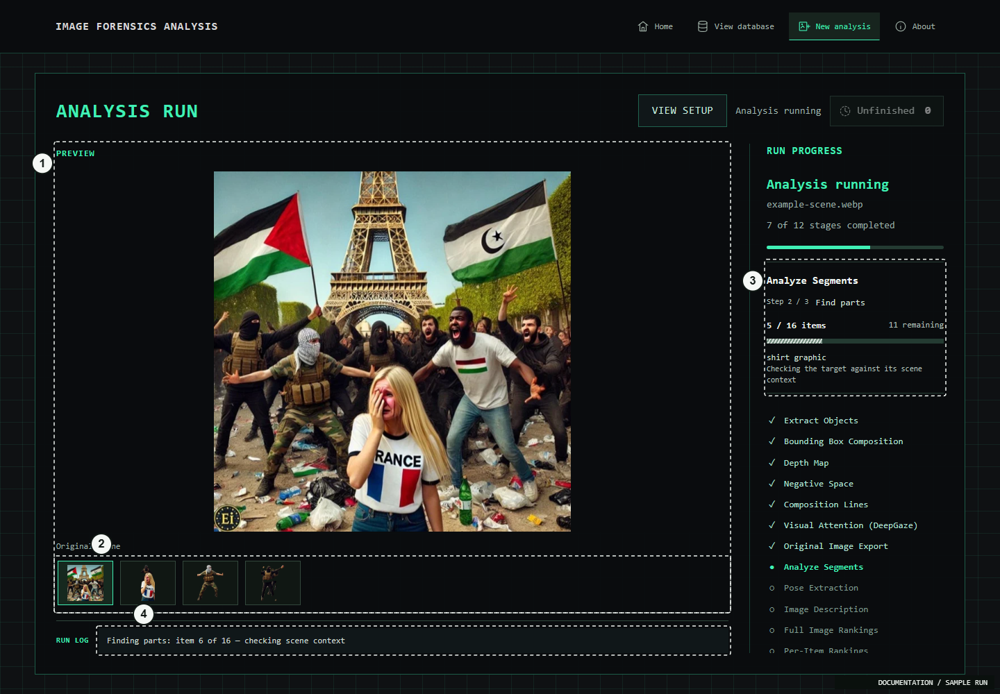

*Illustrative run state; no analysis is started to capture this screen.*

1. **Main preview.** Shows the selected output image at a contained scale. Depending on the stage this can be a scene overlay, mask, crop, depth output or an analysis context board.
2. **Output thumbnails.** Select a thumbnail to inspect another generated image. These are intermediate previews; the frontend saves the complete dataset after the backend finishes.
3. **Stage and item progress.** The right panel reports overall completed stages and the current stage’s substeps. Item totals, skipped items and the current activity explain work within a stage. Stages differ in cost, so stage counts are not a time estimate.
4. **Latest log line.** The footer keeps the newest message visible without crowding the preview. Expand the full log when diagnosing an error. View setup lets you inspect the configuration while the run continues; active runs keep their saved configuration snapshot.

On success, results are downloaded into this frontend and View results becomes available. If only the download fails, Retry download retrieves the completed backend output without rerunning the models. Keep the launcher terminals open while working; closing an owning terminal stops its services.

## Resume unfinished work

If a run fails or is interrupted, open Unfinished next to the main action buttons.

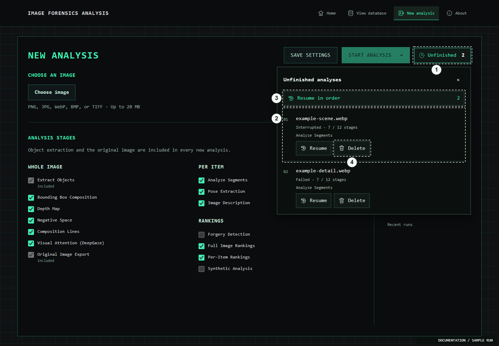

*Illustrative run state; no analysis is started to capture this screen.*

1. **Unfinished count.** Shows failed, interrupted and queued analyses available to this backend. This is separate from completed results already stored in the frontend database.
2. **Run and last stage.** Each row shows the filename, saved progress and relevant stage. Select the filename to inspect its log and previews. Fix the underlying problem, such as an unavailable model service, before resuming.
3. **Resume in order.** Queues the listed unfinished analyses in order. An individual Resume starts or queues just that row. The backend checks saved inputs, configuration and output files, preserves valid completed work, and reruns from the first missing or invalid dependency.
4. **Delete.** Removes the selected unfinished backend run and its files only after you confirm Delete permanently. Use Cancel to keep it. Deleting an unfinished run is different from browsing a previously downloaded result.

Resume does not automatically adopt newly edited global defaults: it uses the original run’s saved settings and prompts. After a code update, restart the owning backend launcher so the service loads the new code, then resume.

## Open a saved result

Choose View database, then select an image card.

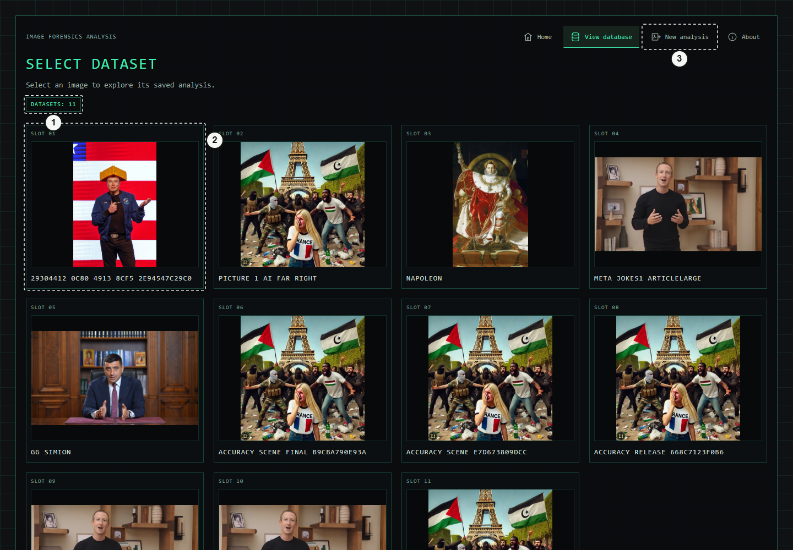

1. **Dataset count.** Counts saved analyses available to this viewer. The included database and downloaded results are read from the frontend’s data source, independently of the running backend.
2. **Result card.** The thumbnail and name identify a saved dataset. Select the card to open its image views and recorded outputs. A saved result includes its images and JSON files together; one loose crop is not a complete analysis.
3. **Return to analysis.** Use New analysis to create or resume a run. A dataset in the viewer stays readable after the backend stops; starting new work requires the backend again.

Keep the complete result folder when backing up or moving analyses. Available views depend on the stages that ran and the files they produced. Older examples may contain fewer outputs than the full workflow shown here.

## Inspect the scene and its elements

Use the image-view pictograms to move between the saved scene views. Select an element when you need its local evidence.

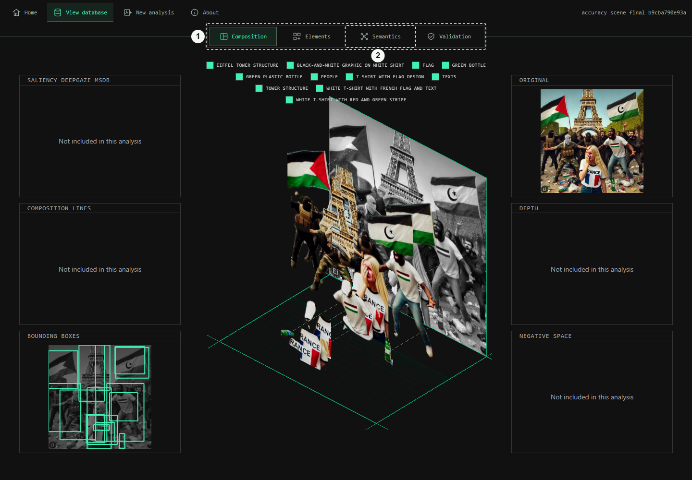

1. **Image-view navigation.** The pictograms switch between Composition, Elements, Semantics and Validation views. These are different ways to inspect the same saved dataset; they do not start a new analysis.
2. **Semantics.** Opens the whole-image score profile, rating gauges, item balance, distributions and clusters. Use this when comparing the meanings and relationships recorded in an analysis.

Composition brings together the original and available spatial outputs such as bounding boxes, depth, composition lines and visual attention. Elements exposes detected objects and their parts, with their saved descriptions and measurements. Validation presents available forensic outputs; a missing stage cannot be recovered by switching views.

## Read whole-image ratings

Open Semantics. Read the scene-level ratings, then select a gauge or chart sector to reveal its evidence.

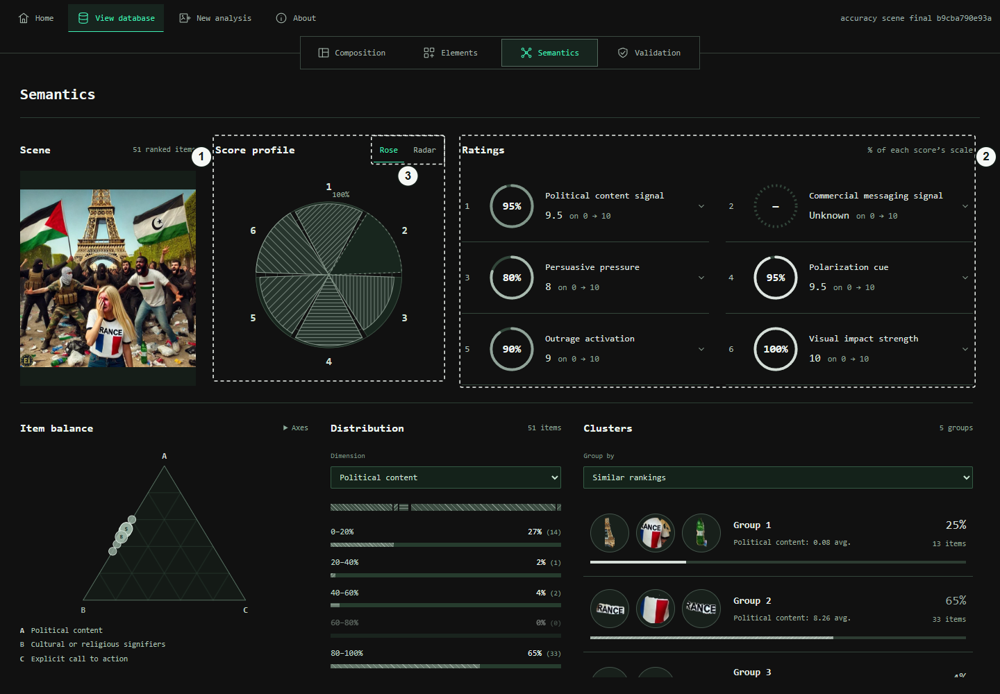

1. **Rose / Radar profile.** Compares numeric criteria using their configured scales. Rose uses hatched sectors; Radar changes the profile shape and requires at least three numeric criteria. Missing or categorical answers are not invented as numeric scores.
2. **Rating gauges.** Each gauge shows a value and its criterion label. For a score, the ring expresses position within that score’s range. Choice and Yes / No criteria keep their own answer form. Click a gauge to open its recorded explanation.
3. **Change the profile view.** Rose and Radar display the same saved ratings. Changing the chart style does not change the analysis or its ranking values.

For a 0–10 score, 8 appears as 80% of scale. For a −5 to 5 score, 0 is halfway through the scale. These graphics summarize the configured questions; they do not certify authenticity, identity, political affiliation or intent. Read the supporting explanation and the original image together.

## Find patterns across items

Continue down Semantics. Select a cluster, a distribution bar or a pyramid point to see the items behind it.

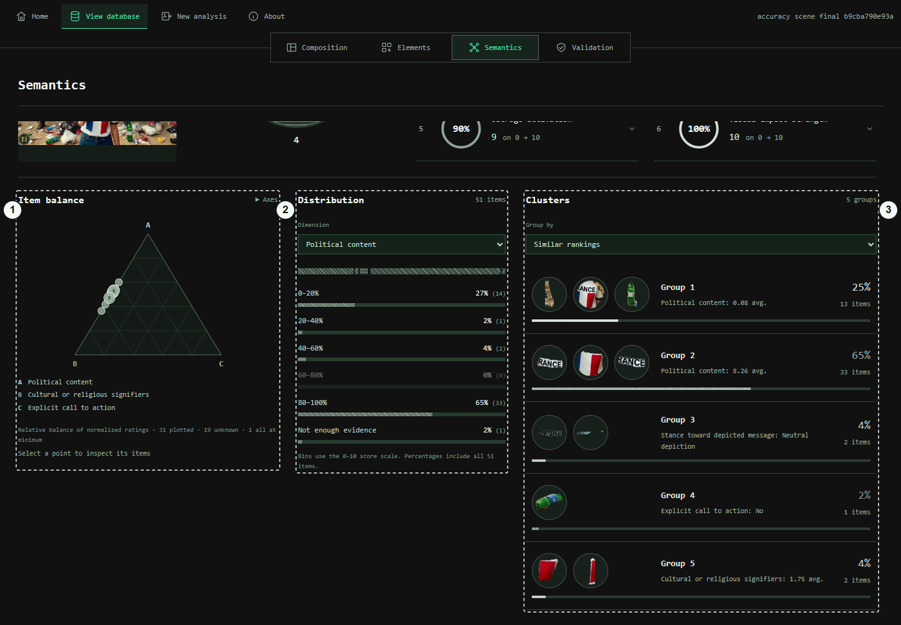

1. **Item balance pyramid.** Projects the relative balance of three score or Yes / No criteria. Axes lets you choose those dimensions. Nearby points can represent several items; select a point to inspect its members. Unknown and all-minimum cases are reported separately.
2. **Distribution.** Choose a criterion to see how its answers are distributed across items. The percentages refer to item counts, including unknown answers where shown. Selecting a bar reveals the matching items.
3. **Clickable clusters.** Group by similar rankings or a particular criterion. Each group shows item previews, a count/share and a short summary. Select it to reveal its members, then select a member to open the item inspector.

Explore items & rankings expands the detailed browser below these graphics. Search narrows items or parts; scope and category filters refine the list; Reset clears filters. Similarity groups reflect the saved ranking answers, not an independent conclusion about real-world relationships.

## Check the evidence for one item

Select an item from a cluster or chart. Its inspector opens over the overview.

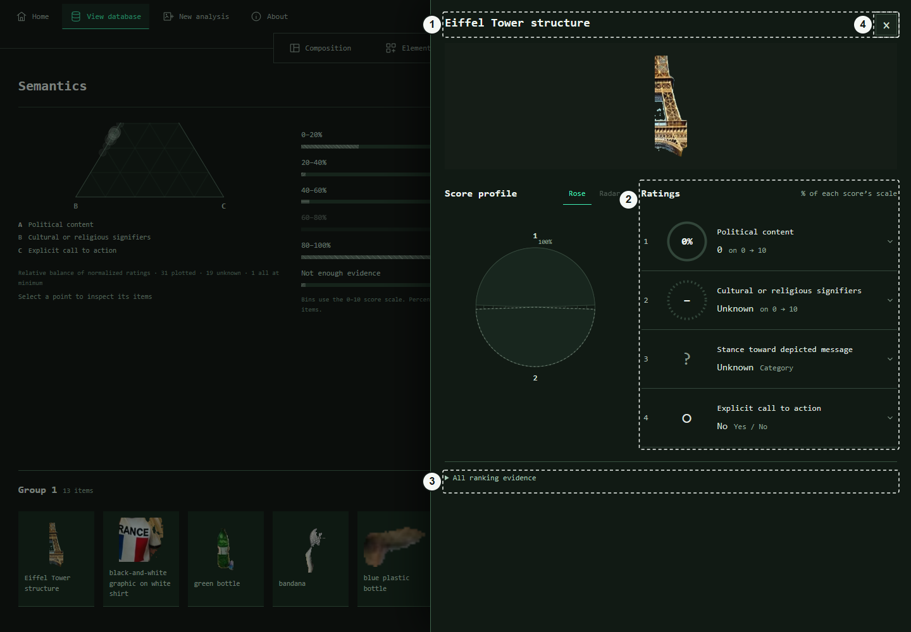

1. **Item identity and context.** The heading names the selected item; parts can show their parent object. The crop identifies the target. Compare it with the full scene before interpreting a small or ambiguous region.
2. **Item ratings.** These are the selected object’s or part’s answers, not the whole-image ratings. The labels, numeric ranges and categories come from the criterion definitions saved with that run.
3. **All ranking evidence.** Expand to read every saved criterion value and its supporting explanation. You can also select an individual gauge or profile sector for focused evidence. Unknown values remain distinguishable from zero or No.
4. **Return to the overview.** Close the inspector with this button or Escape. Your cluster selection remains available, so you can inspect another item without opening a separate page.

Editing a new analysis profile does not relabel an existing result retroactively. The viewer uses the saved descriptors so analyses with different questions, criterion names and answer types remain readable.

## Stage reference

Use the Executor checkboxes to select these stages. A view appears only when its corresponding output exists.

| Component | What it does |
| --- | --- |
| Extract Objects | Detects visible people, objects and text, then extracts regions and masks. Required for a new image. |
| Bounding Box Composition | Records the layout and spatial relationships of detected bounding boxes. |
| Depth Map | Estimates relative scene depth; it is not a calibrated distance measurement. |
| Negative Space | Analyzes space around the detected foreground elements. |
| Composition Lines | Saves geometric composition guides and line-related outputs. |
| Visual Attention (DeepGaze) | Estimates a visual-attention or saliency map; it does not measure an actual viewer’s gaze. |
| Original Image Export | Saves a viewer-friendly original-image asset. Included in every new analysis. |
| Analyze Segments | Finds meaningful parts within extracted items and retains their parent relationships. |
| Pose Extraction | Extracts available body-pose/keypoint information for detected people. |
| Image Description | Answers the configured description questions for eligible items and parts. |
| Forgery Detection | Runs the installed forensic methods and saves their available detection/localization outputs. Requires the optional forgery installation. |
| Full Image Rankings | Evaluates configured criteria against the whole scene. |
| Per-Item Rankings | Evaluates configured criteria for eligible objects and parts. |
| Synthetic Analysis | Runs the optional synthetic-image classifier. Its score is model output, not a guarantee of origin. |

## When something needs attention

| Component | What it does |
| --- | --- |
| Backend unavailable | Start the backend, wait for its API-ready message, then Try again. The setup guide explains the separate backend installation. Saved results remain available without it. |
| Start analysis is disabled | Choose an image, complete any highlighted question/criterion fields, and wait for an active run to finish. |
| The old error remains after an update | Restart the terminal that owns the backend. Reopening a browser tab cannot reload Python code in a running service. Then use Unfinished → Resume. |
| A stage stops | Open the full run log to find the actual error. Restore the required service or model, then Resume; valid earlier work is checked and reused. |
| Analysis finished, but results did not download | Use Retry download. This transfers completed output to the frontend rather than starting the models again. |
| A chart or layer is missing | Check which stages were selected and whether the saved dataset contains their outputs. Custom categorical criteria do not automatically produce numeric profile axes. |

## Keep this guide current

The images and this page are generated from one editable guide definition. See [Screenshot workflow](SCREENSHOTS.md) to capture new UI images and rebuild the GitHub page and local HTML preview.
